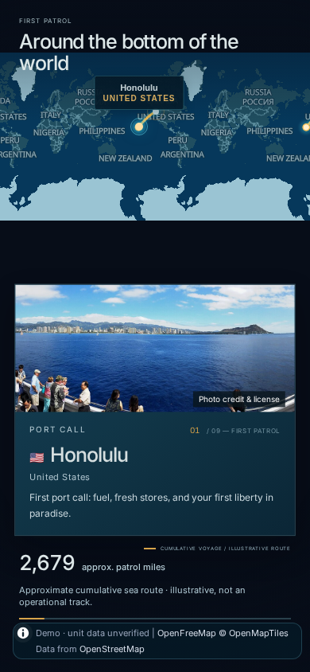
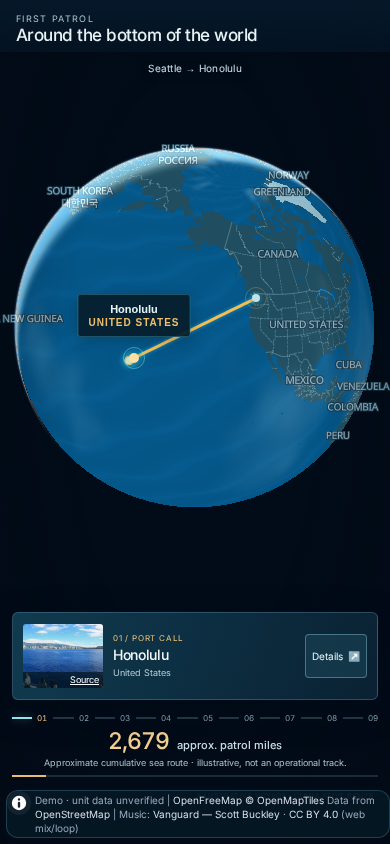
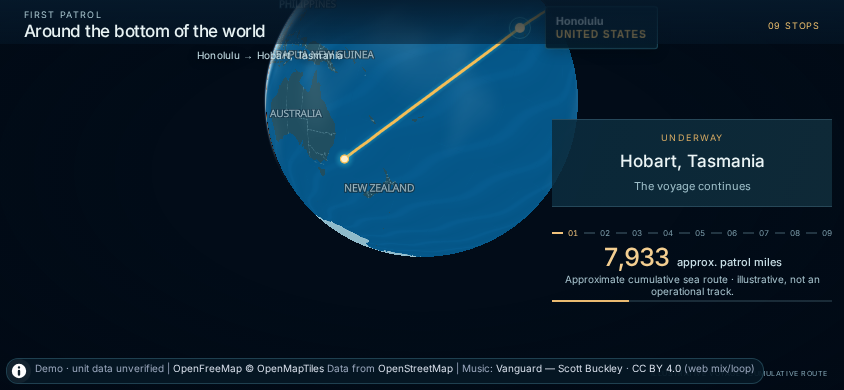
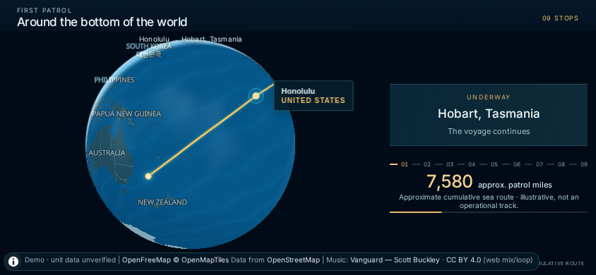

# Native globe and audio — genuine verification evidence

These are actual browser screenshots, not concept art or generated “after” images. Application source is `96683727af7a8c72ca0e23980d922f52c0524176`; later documentation commits preserve the same tested bundle. [PR #7](https://github.com/gocoastnola/CoastGuardInteractive/pull/7) records subsequent CI. Publication is held after automatic approval review rejected the merge under the original no-merge/no-deploy instruction; these are local final-source screenshots, not a claim that the new version is live.

## Matched phone comparison

Both frames show Honolulu at **390×844 CSS pixels**, with live geographic resources and photographs. Before is the deployed `481c4c98b31451541c6ceae26158b9f08f122571` version captured at 15:43 UTC; after is the final native-globe source. The new photo dock is 88px tall and its larger gallery opens only on request.

| Before | After |
| --- | --- |
|  |  |

## Other inspected scenes

- [Original four-corner mission opening retained](opening-four-missions.png) — actual desktop ZIP screen, no assignment spoiler.
- [Short portrait phone, 390×664](phone-honolulu-390x664.png) — 372px globe stage and 56px reserved provider/music attribution row.
- [Desktop McMurdo arrival](desktop-mcmurdo.png) — wide Antarctic context, cumulative route, small port dock.
- [Explicitly requested McMurdo gallery](requested-mcmurdo-gallery.png) — real source credits and Close remain usable. At maximum scroll the map attribution covers part of the optional bottom narrative note; this is a recorded limitation.

## Matched rotation repair

Both landscape frames are **844×390**, immediately after rotating during Honolulu → Hobart. Before retained portrait padding and cropped the sphere; after immediately fits the physical sphere while preserving the remaining camera passage. This is separate from a fresh-load landscape check.

| Reproduced defect | Repaired |
| --- | --- |
|  |  |

[Exact native camera/stage measurements](rotation-measurements.json) show the repaired landscape globe center matches its stage center `(270.1953125, 205)` to floating-point precision.

## Verification and limits

[Verification summary](verification-summary.json) preserves actual local results, all-nine-stop camera observations, scene timestamps, real recorded-audio signal samples and measured software-renderer limits. [Recovery verification](recovery-verification.json) records unchanged remote recovery tags and independent backup refs/hosted hashes. [Screenshot hashes](screenshots.json) identify the eight original PNGs.

Actual Node 22.23.5: **79 unit tests**, **18 demo-unverified records**, production build, **3 targeted Chromium regressions**, **7 production-subpath checks** and **7 native WebKit checks** passed. The first full local Chromium run was 15/17; its two harness failures and the later targeted passes are distinguished in the report. The full real-resource desktop story and focused phone voyage completed. Deterministic automated tests use external style/photo fixtures; these screenshot runs use actual resources. The phone run uses existing Skip controls before the voyage, and does not replace the complete normal-timing phone suite.

The actual Vanguard recording advanced through one player/context and produced finite, non-silent master samples; this is playback verification, **not a listening assessment**. A desktop icebreaking-photo request returned 503 and displayed an honest placeholder; the phone's four McMurdo images loaded. Some arrival snapshots have finer geographic tiles still pending. Graphics were measured on ANGLE/Vulkan **SwiftShader**, not phone hardware. Physical-device performance and real iPhone Safari remain untested. No retouching, clock acceleration, camera override or omitted destination is used to manufacture the screenshots.

Photography retains its original source/usage obligations: see [ASSET_LICENSES.md](../../../ASSET_LICENSES.md). Recorded music is **Vanguard — Scott Buckley, CC BY 4.0**, with in-app attribution and a [bundled credit](../../../public/media/music/ATTRIBUTION.txt).
