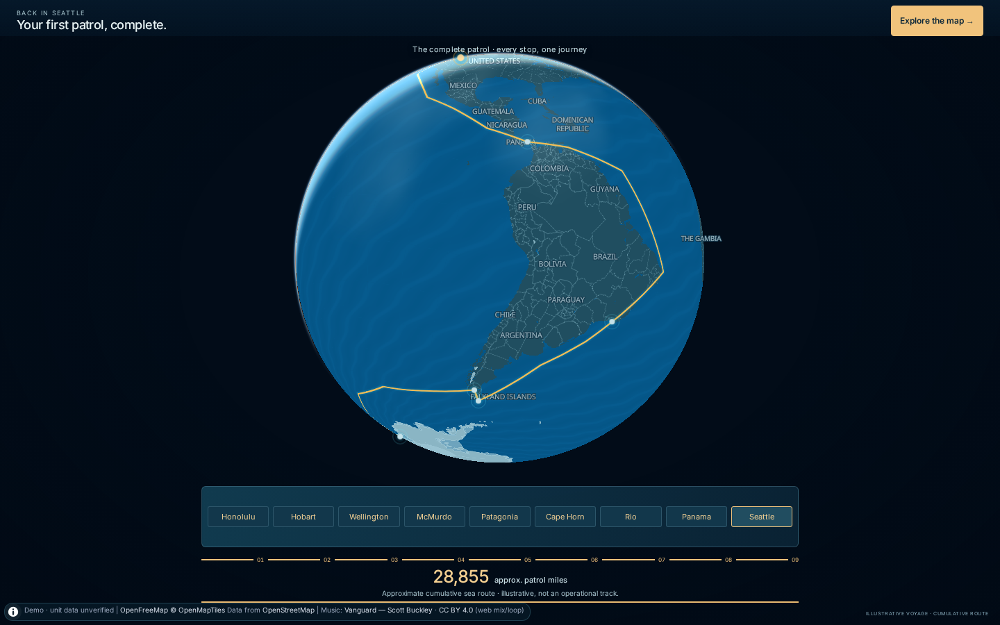
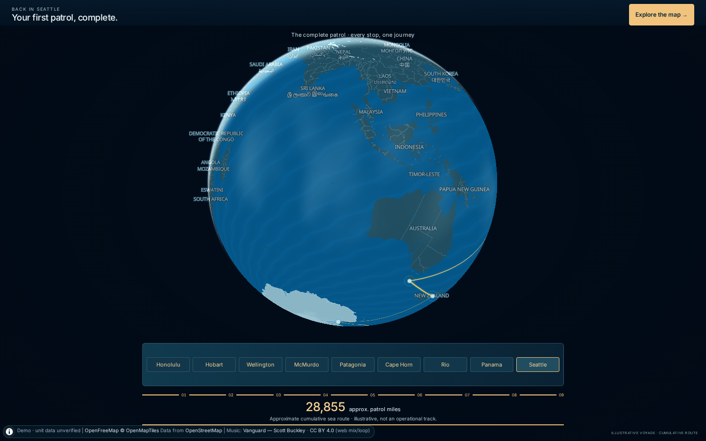
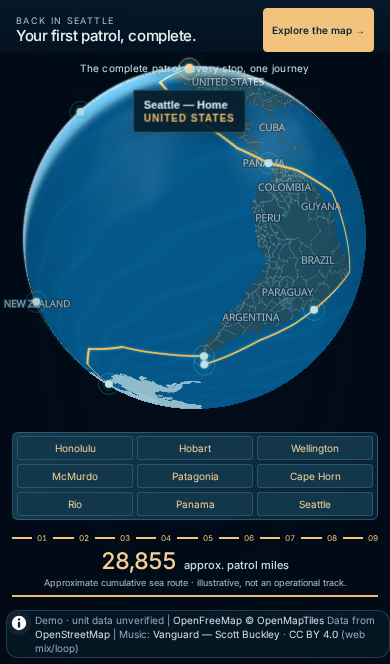
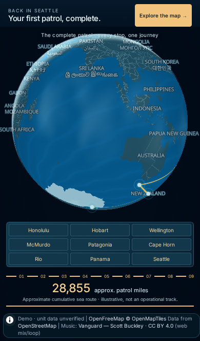

# Completed patrol — actual production-build evidence

These screenshots show the real production build at `/CoastGuardInteractive/`, using live map tiles and existing photographs. They are not concepts, retouched images or a claim of publication. [PR #8](https://github.com/gocoastnola/CoastGuardInteractive/pull/8) records subsequent deployment and public-site verification.

| Desktop hemisphere 1 | Desktop hemisphere 2 |
| --- | --- |
|  |  |

| Phone hemisphere 1 | Phone hemisphere 2 |
| --- | --- |
|  |  |

[Wide-phone landscape](phone-landscape.png) and [portrait restored](phone-restored.png) preserve the completed patrol across the 860px layout breakpoint. The 390×664 recap retains the existing 372px globe stage, clear mileage/credits and a 44px Explore control.

[Production observations](production-observations.json) retain actual nine-stop arrival order/timestamps, full native route geometry, all nine requested galleries, five hemisphere frames per viewport, errors/warnings and exit results. [Chromium orbit](chromium-orbit.json) and [WebKit orbit](webkit-orbit.json) measure actual native longitude through a complete turn with constant bearing. [Focused Chromium ledger](focused-chromium.json) distinguishes the recorded local runs; full CI passed all 18 Chromium and eight production cases. [Screenshot hashes](screenshots.json) identify the six original PNGs.

Tests do not skip destinations or accelerate the patrol clock. Existing Skip controls are used only before the focused patrol captures. Automated deterministic tests use external style/photo fixtures; these production screenshots use actual geographic resources and photographs. The tests retain the original four-photo ZIP opening and story.

The renderer is software SwiftShader, not a physical phone GPU. Real-device smoothness and subjective listening are not claimed. ReadPixels performance warnings and the existing optional `circle-11` style warning remain in the logs. A small Seattle-label/status overlap and the existing attribution overlap over optional scrollable gallery content are disclosed in the [pacing report](../../PATROL-PACING.md); essential recap, source and exit controls remain usable.

Source, photograph and music credits remain in [ASSET_LICENSES.md](../../../ASSET_LICENSES.md). No imagery, recording, route data, dependency, backup or recovery reference was changed for this revision.
