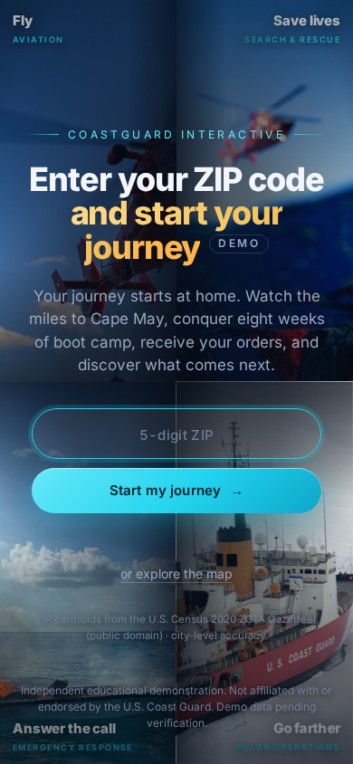
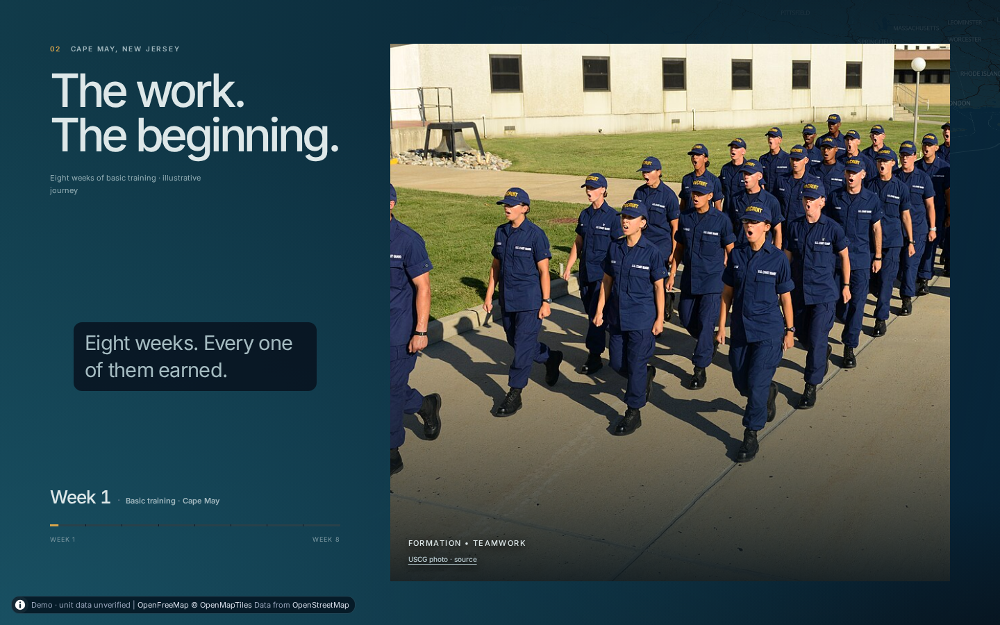
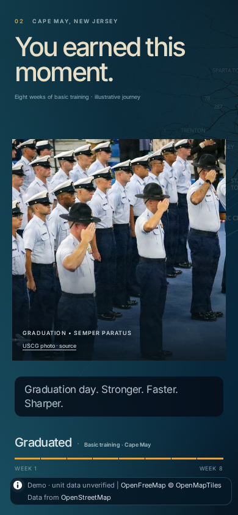
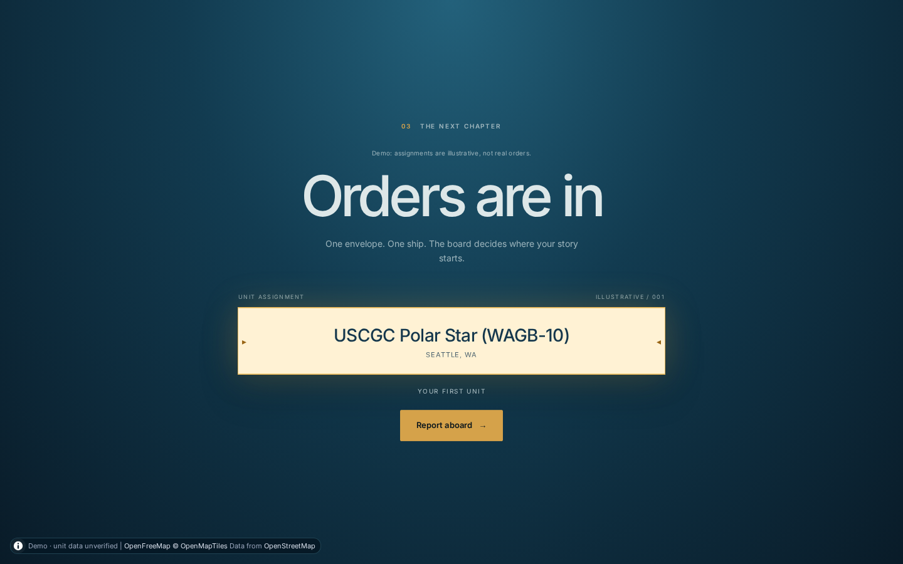
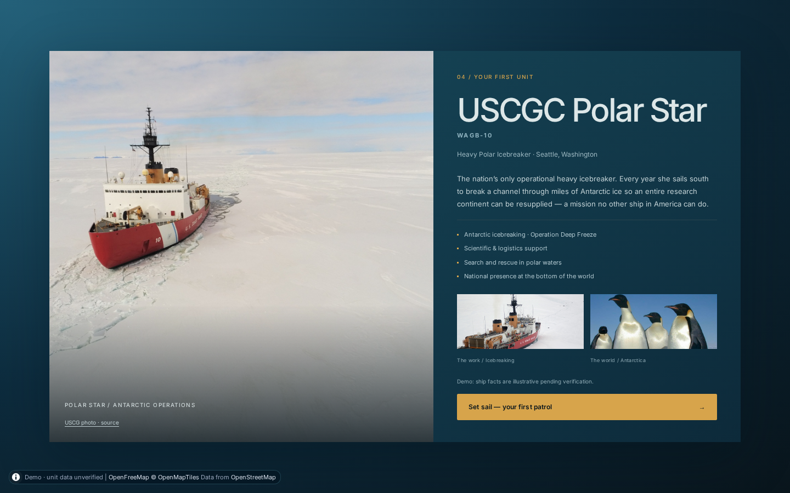
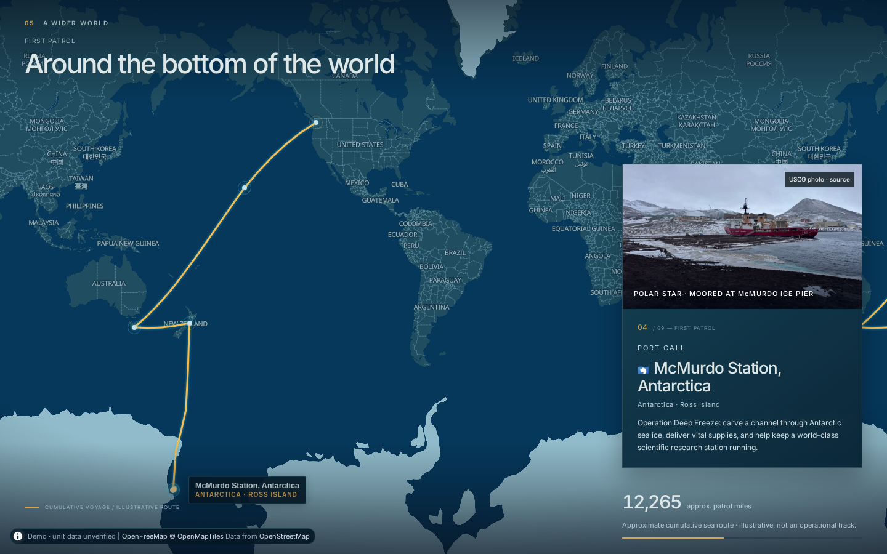
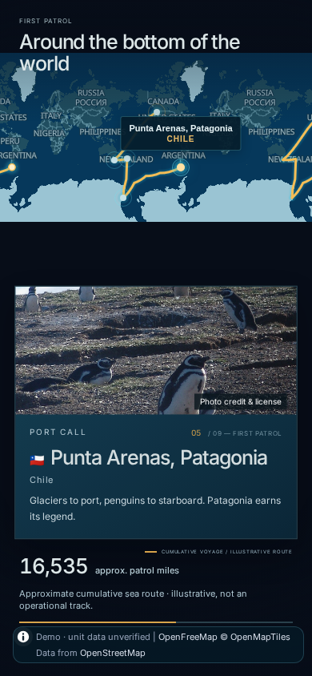
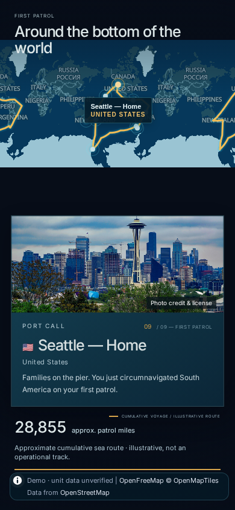
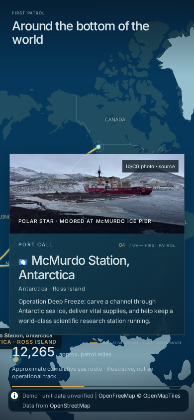
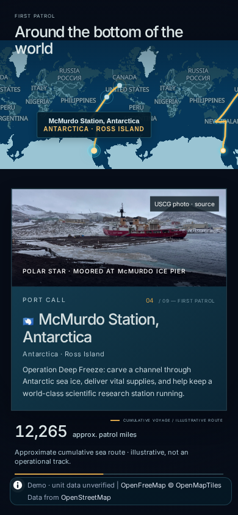

# Actual rendered visual evidence

Chromium with live external resources; phone views are emulation. Original four-photo opening and complete voyage retained. These are screenshots of implemented scenes, not concepts.

## Original four-photo ZIP opening

## Training, desktop

## Graduation, phone

## Orders reveal, desktop

## Report aboard, desktop

## McMurdo, desktop

## Patagonia, phone

## Homecoming, phone

## Development before camera correction — same phone and scene

## After camera correction — same phone and scene

